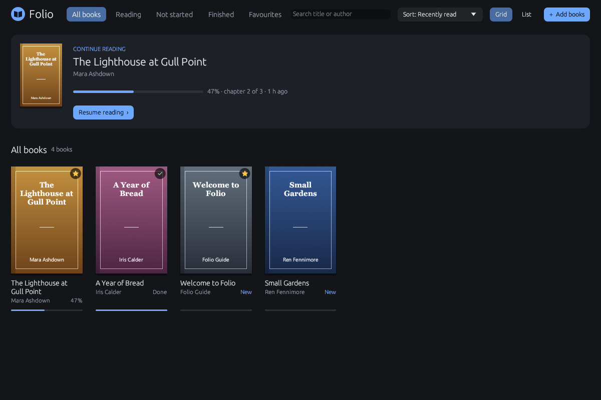
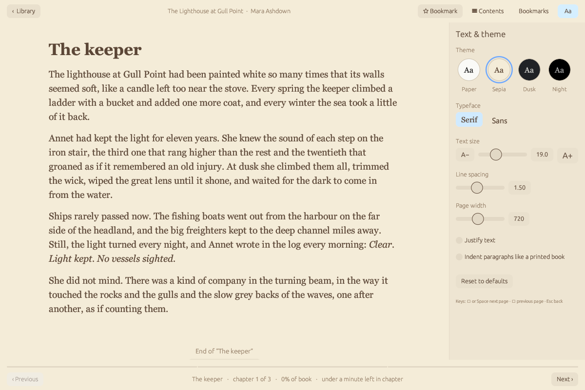
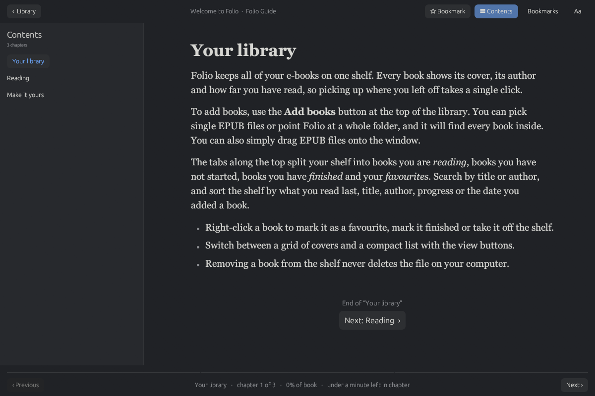
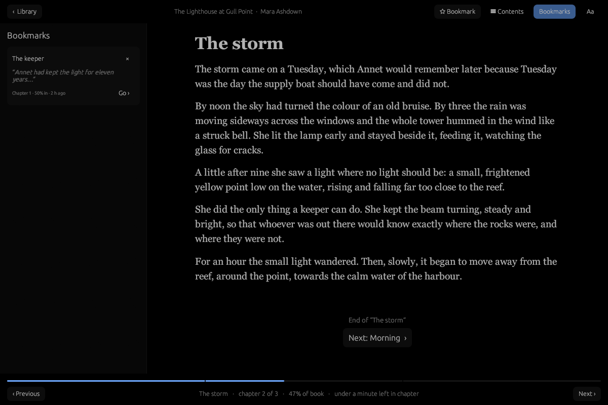
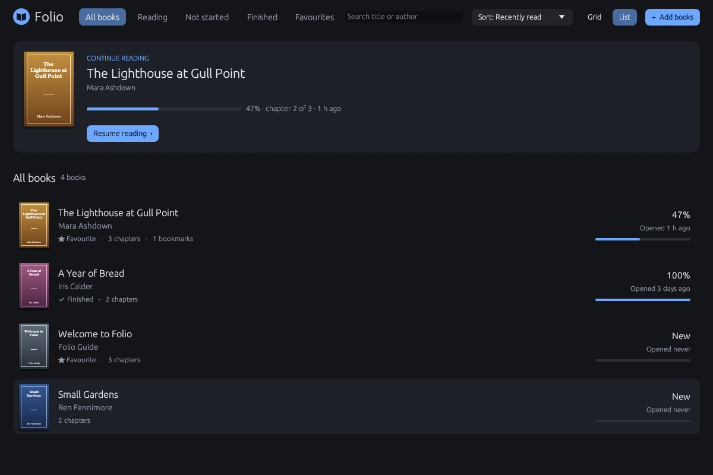
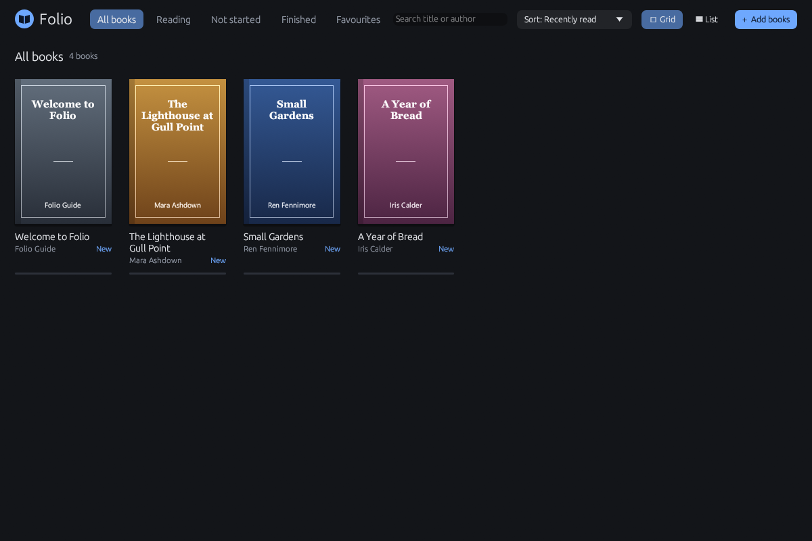
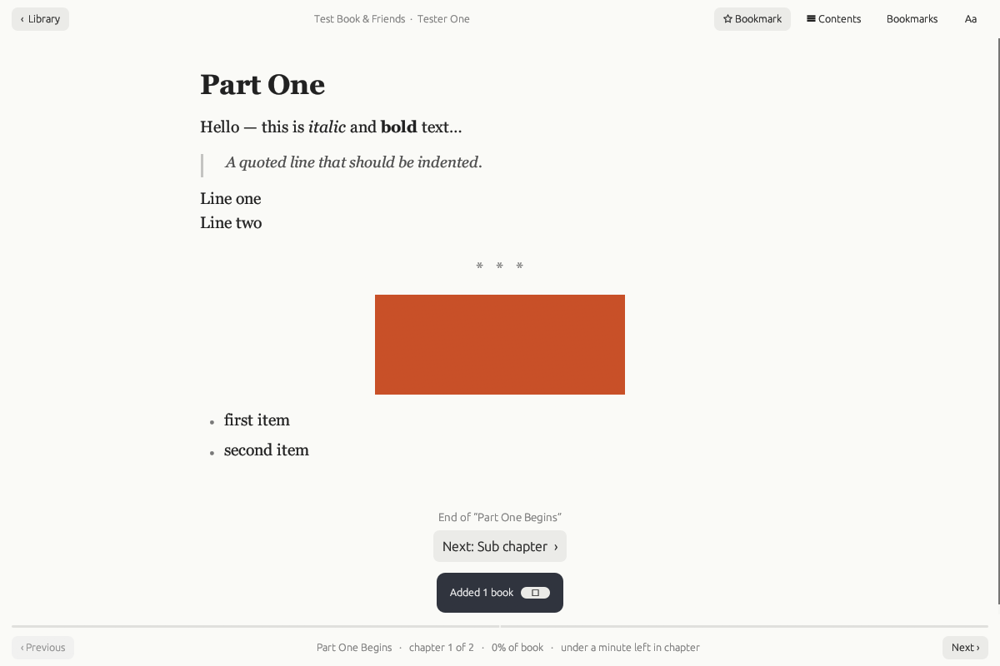

<div align="center">


# Folio

**Um leitor de e-books leve, bonito e sem distrações.**

Organize sua estante de EPUBs e leia com o conforto de um livro de papel no Windows, macOS e Linux.

[](https://github.com/dante-ernande/folio/actions/workflows/build.yml)
[](https://github.com/dante-ernande/folio/actions/workflows/rust.yml)
[](https://github.com/dante-ernande/folio/releases/latest)
[](LICENSE)


<br>



</div>

---

## ✨ Recursos

<table>
<tr>
<td width="50%" valign="top">

### 📚 Biblioteca
- Estante com **capas**, autor e **progresso** de cada livro
- Cartão **“Continue lendo”** para voltar de onde parou com um clique
- Abas: *Todos*, *Lendo*, *Não iniciados*, *Concluídos* e *Favoritos*
- **Busca** por título ou autor
- Ordenação por leitura recente, título, autor, progresso ou data de adição
- Visualização em **grade** ou **lista**
- Adicione arquivos `.epub` ou uma **pasta inteira**, ou simplesmente **arraste e solte** na janela

</td>
<td width="50%" valign="top">

### 📖 Leitura
- 4 temas: **Papel**, **Sépia**, **Crepúsculo** e **Noite**
- Fonte **serifada** ou **sem serifa**
- Ajuste de tamanho do texto, espaçamento entre linhas e largura da página
- Texto justificado e recuo de parágrafo como em livro impresso
- **Sumário**, **marcadores** com trecho do texto e tempo estimado de leitura
- Atalhos: <kbd>→</kbd> / <kbd>Espaço</kbd> / <kbd>PgDn</kbd> avança, <kbd>←</kbd> / <kbd>PgUp</kbd> volta, <kbd>Esc</kbd> retorna à biblioteca
- Seu progresso e suas preferências são **salvos automaticamente**

</td>
</tr>
</table>

## 🖼️ Capturas de tela

<table>
<tr>
<td align="center"><br><sub><b>Tema Sépia</b> e painel de texto e tema</sub></td>
<td align="center"><br><sub><b>Sumário</b> no tema Crepúsculo</sub></td>
</tr>
<tr>
<td align="center"><br><sub><b>Marcadores</b> no tema Noite</sub></td>
<td align="center"><br><sub>Biblioteca em <b>lista</b></sub></td>
</tr>
<tr>
<td align="center"><br><sub>Biblioteca em <b>grade</b></sub></td>
<td align="center"><br><sub>EPUB com <b>formatação, imagens e listas</b></sub></td>
</tr>
</table>

## ⬇️ Download

Baixe o instalador da sua plataforma na página de **[Releases](https://github.com/dante-ernande/folio/releases/latest)**:

| Plataforma | Arquivo | Observação |
|---|---|---|
| 🪟 **Windows** (x64) | `..._x64-setup.exe` | O SmartScreen pode avisar. Clique em *Mais informações → Executar assim mesmo* |
| 🍎 **macOS** (Intel) | `.dmg` | Na primeira vez, abra com **botão direito → Abrir** (o app não é assinado) |
| 🐧 **Linux** (x64) | `.AppImage` | `chmod +x *.AppImage` e execute |

## 🛠️ Compilando a partir do código

### Pré-requisitos

- [Rust](https://rustup.rs) (versão estável)
- Dependências do sistema:

<details>
<summary><b>🪟 Windows</b></summary>

Instale o **Visual Studio Build Tools** com a carga de trabalho *“Desenvolvimento para desktop com C++”* (o `rustup` oferece isso na instalação). O ícone é embutido no `.exe` automaticamente pelo `build.rs`.

</details>

<details>
<summary><b>🍎 macOS</b></summary>

```bash
xcode-select --install
```

</details>

<details>
<summary><b>🐧 Linux (Debian/Ubuntu)</b></summary>

```bash
sudo apt-get install -y libxcb-render0-dev libxcb-shape0-dev libxcb-xfixes0-dev \
                        libxkbcommon-dev libgtk-3-dev
```

</details>

### Executável simples

```bash
cargo build --release
```

O programa fica em `target/release/folio` (ou `folio.exe` no Windows). É um arquivo único e não precisa de mais nada.

> 💡 **Windows:** dê um duplo clique em **`build-exe.bat`**. Ao terminar, o **`Folio.exe`** aparece ao lado dele.

### Instaladores nativos

Os instaladores são gerados com o [cargo-packager](https://github.com/crabnebula-dev/cargo-packager). A configuração fica em `[package.metadata.packager]` no `Cargo.toml`.

```bash
cargo install cargo-packager --locked
cargo build --release
```

| Plataforma | Comando | Resultado em `dist/` |
|---|---|---|
| 🪟 Windows | `cargo packager --release --formats nsis` | `folio_0.1.0_x64-setup.exe` |
| 🍎 macOS | `cargo packager --release --formats dmg` | arquivo `.dmg` |
| 🐧 Linux | `cargo packager --release --formats appimage` | arquivo `.AppImage` |

> Cada formato só pode ser gerado no próprio sistema: o DMG no macOS, o AppImage no Linux e o instalador NSIS no Windows. Para gerar todos de uma vez, use o GitHub Actions (abaixo).

### 🚀 Release automática (GitHub Actions)

O workflow [`build.yml`](.github/workflows/build.yml) compila e empacota nas três plataformas em paralelo e publica uma Release com os instaladores:

```bash
# 1. atualize a versão em Cargo.toml ([package] e [package.metadata.packager])
git commit -am "Release v0.1.1"
git tag v0.1.1
git push && git push origin v0.1.1
```

Também é possível rodar o workflow manualmente pela aba **Actions → Build and Pack Release → Run workflow**. Nesse caso os instaladores ficam disponíveis como *artifacts* da execução, sem criar Release.

## 🎨 Ícone

O ícone do app vem de dois arquivos na raiz do projeto:

| Arquivo | Uso |
|---|---|
| `icon.png` (512×512) | Ícone da janela, AppImage e `.icns` do macOS |
| `icon.ico` (16 a 256 px) | Ícone embutido no `.exe` e no instalador do Windows |

Para trocar o ícone, substitua o `icon.png` e gere o `.ico` de novo, por exemplo com Python e Pillow:

```bash
python -c "from PIL import Image; Image.open('icon.png').save('icon.ico', sizes=[(s,s) for s in (16,24,32,48,64,128,256)])"
```

## 🗂️ Estrutura do projeto

```
├── src/
│   ├── main.rs      # ponto de entrada, janela e ícone
│   ├── app.rs       # biblioteca: abas, busca, grade/lista, importação
│   ├── reader.rs    # tela de leitura, sumário, marcadores
│   ├── epub.rs      # leitura e extração de arquivos EPUB
│   ├── html.rs      # renderização do conteúdo HTML dos capítulos
│   ├── model.rs     # dados persistidos (livros, progresso, preferências)
│   ├── style.rs     # temas e estilos visuais
│   └── samples.rs   # livros de exemplo
├── shots/           # capturas de tela
├── build.rs         # embute o ícone no .exe (Windows)
├── icon.png / icon.ico
└── .github/workflows/
```

## 📄 Licença

Distribuído sob a licença **Apache 2.0**. Veja [LICENSE](LICENSE).

<div align="center">
<sub>Feito com 🦀 Rust e <a href="https://github.com/emilk/egui">egui</a></sub>
</div>
